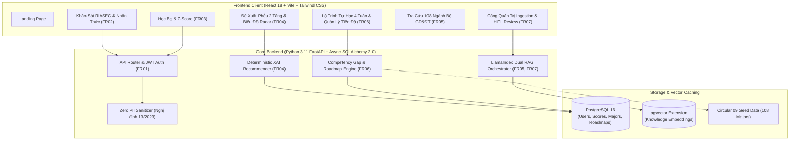

# AI CareerGuide: Hệ Thống Hướng Nghiệp & Đề Xuất Ngành Học XAI Cá Nhân Hóa
> **Capstone Project C1SE.71 – CMU Software Engineering Capstone 1**  
> Nền tảng tư vấn hướng nghiệp giải thích được (Explainable AI - XAI), cá nhân hóa lộ trình học tập và kết nối dữ liệu chuẩn Thông tư 09/2022/TT-BGDĐT dành cho học sinh THPT Việt Nam.

---

## 🌟 1. Giới Thiệu Dự Án (Project Overview)

**AI CareerGuide** giải quyết triệt để thực trạng học sinh THPT chọn sai ngành nghề do thiếu thông tin chuẩn mực và phụ thuộc vào các mô hình AI sinh (GenAI) có rủi ro ảo giác (hallucination). Hệ thống áp dụng:
* **Mô hình Khuyến nghị XAI Tất định 3 Trụ Cột (Deterministic 3-Pillar Model):** Tách bạch $100\%$ giữa tính toán điểm số toán học và mô hình ngôn ngữ lớn (LLM).
* **Mô hình Phễu 2 Tầng (Hierarchical Recommendation):** Tầng 1 (Top 3 Lĩnh vực đào tạo phù hợp nhất) $\rightarrow$ Tầng 2 (Top 2-3 Ngành đào tạo cụ thể theo mã cấp IV của Bộ GD&ĐT).
* **Bảo Mật Dữ Liệu Học Sinh Cấp 2 (Zero PII Guardrails):** Tuân thủ Nghị định 13/2023/NĐ-CP và Luật số 91/2015/QH13, tuyệt đối không gửi thông tin danh tính học sinh sang API bên ngoài.
* **Quy Trình Nạp Tri Thức 2 Luồng (Two-Stream Ingestion & Dual RAG):** Stream A (Thông tư Bộ GD&ĐT) + Stream B (Khám phá lộ trình chuyên ngành có kiểm duyệt HITL).

---

## 📐 2. Cơ Sở Toán Học & Công Thức Đề Xuất 3 Trụ Cột (XAI Mathematical Formulation)

Điểm tương thích tổng hợp của học sinh $u$ với ngành đào tạo $m$ ($S(u, m) \in [0, 100]$) được tính toán hoàn toàn tất định tại Backend:

$$S(u, m) = 100 \times \left( w_1 \cdot S_{\text{RIASEC}}(u, m) + w_2 \cdot S_{\text{Academic}}(u, m) + w_3 \cdot S_{\text{Cognitive}}(u, m) \right)$$

* **Trọng số tiêu chuẩn:** $w_1 = 0.45$ (Sở thích nghề nghiệp Holland), $w_2 = 0.35$ (Học bạ & Tổ hợp môn xét tuyển), $w_3 = 0.20$ (Thiên hướng nhận thức).

### Trụ cột 1: Độ Tương Thích Sở Thích Holland RIASEC ($45\%$)
Sử dụng độ tương tự Cosine giữa vector sở thích của học sinh $\vec{v}_u$ và vector chuẩn hóa của ngành $\vec{v}_m$:
$$S_{\text{RIASEC}}(u, m) = \frac{\vec{v}_u \cdot \vec{v}_m}{\|\vec{v}_u\|_2 \|\vec{v}_m\|_2} = \frac{\sum_{d \in \{R,I,A,S,E,C\}} v_{u,d} \cdot v_{m,d}}{\sqrt{\sum v_{u,d}^2} \sqrt{\sum v_{m,d}^2}}$$

### Trụ cột 2: Năng Lực Học Thuật Điểm Học Bạ & Z-Score ($35\%$)
Chuẩn hóa điểm số từng môn qua phân phối Z-Score quốc gia:
$$Z_{u,s} = \frac{X_{u,s} - \mu_s}{\sigma_s}, \quad \Phi(Z_{u,s}) \in [0, 1]$$
Điểm học thuật là điểm của tổ hợp môn có thành tích cao nhất thuộc danh mục xét tuyển của ngành:
$$S_{\text{Academic}}(u, m) = \max_{b \in B_m} \left( \frac{1}{|b|} \sum_{s \in b} \Phi(Z_{u,s}) \right)$$

### Trụ cột 3: Thiên Hướng Nhận Thức & Phong Cách Học Tập ($20\%$)
Áp dụng ma trận trọng số tương thích nguyên tắc (Rule-based Matrix):
$$S_{\text{Cognitive}}(u, m) = \frac{1}{|K|} \sum_{k \in K} M_k(\text{student\_pref}_k, \text{major\_req}_{m,k})$$

---

## 🏛️ 3. Kiến Trúc Hệ Thống & Các Phân Hệ Chức Năng (System Architecture)



---

## 🚀 4. Hướng Dẫn Cài Đặt & Khởi Chạy (Quickstart Guide)

### Yêu Cầu Môi Trường
* **Python:** 3.11+
* **Node.js:** 18+ (hoặc 20+)
* **Cơ sở dữ liệu (tùy chọn):** PostgreSQL 16 có extension `pgvector` (hệ thống có sẵn chế độ Fallback In-memory / Client-side Resilience).

### Bước 1: Clone Kho Lưu Trữ
```bash
git clone https://github.com/ntanduy25/AI-CAREERGUIDE.git
cd AI-CAREERGUIDE
```

### Bước 2: Cấu Hình Biến Môi Trường
```bash
cp .env.example .env
```

### Bước 3: Cài Đặt & Chạy Backend
```bash
# Tạo môi trường ảo Python
python -m venv venv
# Kích hoạt trên Windows
.\venv\Scripts\activate
# Kích hoạt trên Linux/macOS
# source venv/bin/activate

# Cài đặt thư viện
pip install -r backend/requirements.txt

# Khởi chạy server FastAPI
py -3.11 -m uvicorn app.main:app --app-dir backend --host 127.0.0.1 --port 8000 --reload
```
* Tài liệu Swagger UI: [http://127.0.0.1:8000/docs](http://127.0.0.1:8000/docs)
* Tài liệu ReDoc: [http://127.0.0.1:8000/redoc](http://127.0.0.1:8000/redoc)

### Bước 4: Cài Đặt & Chạy Frontend
```bash
cd frontend
npm install
npm run dev -- --host 127.0.0.1 --port 5173
```
* Giao diện người dùng: [http://127.0.0.1:5173](http://127.0.0.1:5173)

---

## 🧪 5. Kiểm Thử Hệ Thống (Automated Testing & Verification)

### Chạy Kiểm Thử Backend (Pytest Suite)
Hệ thống tích hợp bộ 64 bài kiểm thử tự động bao phủ thuật toán 3 trụ cột, tính tất định, phân tích lỗ hổng kỹ năng và bảo vệ PII:
```bash
py -3.11 -m pytest
```
*Kết quả:* **64 passed in ~4.7s (100% PASS)**.

### Kiểm Tra Biên Dịch Frontend (TypeScript & Vite)
```bash
cd frontend
npm run build
```
*Kết quả:* `tsc -b && vite build` thành công, **0 errors**, xuất bản `dist/` tối ưu hóa.

---

## 🛡️ 6. Tuân Thủ An Toàn & Bảo Mật Dữ Liệu (Security & Compliance)

* **Zero PII Leakage:** Toàn bộ thông tin định danh (họ tên, email, trường lớp, số điện thoại) được cô lập nội bộ. Trước khi nạp vào LlamaIndex hoặc gửi sang API ngoài, dữ liệu luôn đi qua bộ lọc regex làm sạch PII (`[REDACTED_EMAIL]`, `[REDACTED_PHONE]`).
* **Argon2id Hashing:** Mật khẩu tài khoản được mã hóa bằng thuật toán Argon2id chống tấn công Rainbow table và GPU brute-force.
* **Role-Based Access Control (RBAC):** Tách biệt rạch ròi giữa giao diện học sinh (`STUDENT`) và cổng quản trị viên (`ADMIN`). Toàn bộ tính năng kiểm duyệt nội dung nạp tri thức HITL yêu cầu quyền Admin.

---

## 👥 Nhóm Tác Giả & Bản Quyền
* **Capstone Team C1SE.71** – CMU Software Engineering Capstone
* **Đại diện kỹ thuật:** Nguyễn Tấn Duy ([@ntanduy25](https://github.com/ntanduy25))
* **Email:** ntanduy1122@gmail.com
